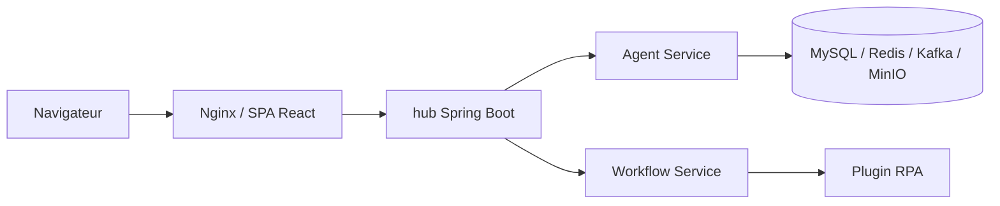

# iflytek/astron-agent

> iFLYTEK enterprise platform for designing agents and workflows, with RPA, models and MCP tools.

## The problem
Teams want to orchestrate agents, models and business tools on a platform they can deploy themselves.

## What it actually does
React console and Java Spring Boot backend for the interface, Python and Go microservices (agent, knowledge, memory, workflow, plugins, tenants) on MySQL, Redis, Kafka and MinIO. Integrates RPA and tools from the iFLYTEK ecosystem, with models via API or on-premises MaaS.

## How it is wired


## Trying it
```bash
git clone https://github.com/iflytek/astron-agent.git
cd docker/astronAgent
cp .env.example .env
docker compose -f docker-compose-with-auth.yaml up -d
```

## Cost and gotchas
Heavy stack (eight or more infrastructure services). Casdoor initialization and password migration must be done before startup; default credentials `admin`/`123` must be changed. The Helm chart is "coming soon".

## What it is not
Not lightweight nor library-oriented. Part of the value goes through the iFLYTEK ecosystem (Astron Cloud, tools from their platform).

## Alternatives
None named in the README apart from SkillHub and AstronRPA (sister projects).

## For you
Worth watching: complete self-hostable agent platform, but heavy and centered on the iFLYTEK ecosystem; test it only if you have an enterprise RPA need.
