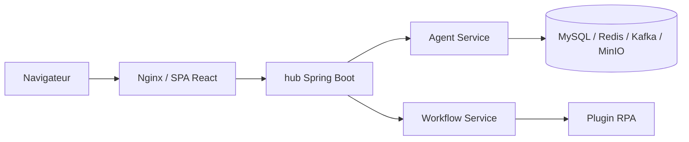

# iflytek/astron-agent

> Plateforme d'entreprise d'iFLYTEK pour concevoir des agents et workflows, avec RPA, modèles et outils MCP.

## Le problème
Les équipes veulent orchestrer des agents, modèles et outils métier sur une plateforme déployable chez elles.

## Ce que ça fait vraiment
Console React et backend Java Spring Boot pour l'interface, microservices Python et Go (agent, connaissances, mémoire, workflow, plugins, locataires) sur MySQL, Redis, Kafka et MinIO. Intègre RPA et outils de l'écosystème iFLYTEK, avec modèles via API ou MaaS sur site.

## Comment c'est branché


## Essayer
```bash
git clone https://github.com/iflytek/astron-agent.git
cd docker/astronAgent
cp .env.example .env
docker compose -f docker-compose-with-auth.yaml up -d
```

## Coût et pièges
Pile lourde (huit services d'infrastructure ou plus). Initialisation Casdoor et migration de mot de passe à faire avant le démarrage ; identifiants par défaut `admin`/`123` à changer. Le chart Helm est « à venir ».

## Ce que ce n'est pas
Pas léger ni orienté bibliothèque. Une partie de la valeur passe par l'écosystème iFLYTEK (Astron Cloud, outils de leur plateforme).

## Alternatives
Aucune nommée dans le README hors SkillHub et AstronRPA (projets frères).

## Pour toi
À surveiller : plateforme d'agents complète à auto-héberger, mais lourde et centrée sur l'écosystème iFLYTEK ; à tester seulement avec un besoin RPA d'entreprise.

