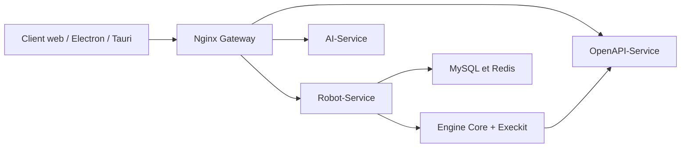

# iflytek/astron-rpa

> Windows desktop RPA application, designed visually, to automate software and web pages in the enterprise.

## The problem
Automating repetitive tasks on desktop software and ERPs without APIs requires custom development.

## What it actually does
Low-code visual designer with more than 300 atomic capabilities (Excel, Word, PDF, browser, GUI, vision, e-mail, AI). Server side: Java Spring Boot and Python FastAPI services, Nginx gateway, MySQL, Redis, Casdoor authentication. The Python execution engine communicates over WebSocket; scheduled, API or MCP triggering, and two-way calls with Astron Agent.

## How it is wired


## Trying it
```bash
git clone https://github.com/iflytek/astron-rpa.git
cd astron-rpa/docker
cp .env.example .env
docker compose up -d mysql casdoor
python3 scripts/sync-casdoor-credentials.py
docker compose up -d
```

## Cost and gotchas
Windows 10/11 client, 8 GiB of RAM, domain and HTTPS certificate to provide. Heavy build chain: Node 22, Python 3.13, JDK 8+, pnpm, UV, SWIG.

## What it is not
Not a data pipeline automation tool: it is desktop RPA, centered on Windows and Chinese software such as Kingdee and YonYou.

## Alternatives
- astron-agent: agent platform from the same vendor, coupled to this project.

## For you
Ignore: a Windows RPA use case far from a data/AI/MLOps profile; only the bridge with agents might deserve a second look.
