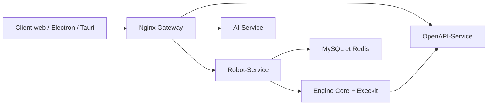

# iflytek/astron-rpa

> Application RPA de bureau Windows, à concevoir visuellement, pour automatiser logiciels et pages web en entreprise.

## Le problème
Automatiser des tâches répétitives sur des logiciels de bureau et des ERP sans API demande du développement spécifique.

## Ce que ça fait vraiment
Concepteur visuel low-code avec plus de 300 capacités atomiques (Excel, Word, PDF, navigateur, GUI, vision, e-mail, IA). Côté serveur : services Java Spring Boot et Python FastAPI, passerelle Nginx, MySQL, Redis, authentification Casdoor. Le moteur d'exécution Python communique par WebSocket ; déclenchement planifié, API ou MCP, et appels bidirectionnels avec Astron Agent.

## Comment c'est branché


## Essayer
```bash
git clone https://github.com/iflytek/astron-rpa.git
cd astron-rpa/docker
cp .env.example .env
docker compose up -d mysql casdoor
python3 scripts/sync-casdoor-credentials.py
docker compose up -d
```

## Coût et pièges
Client Windows 10/11, 8 Gio de RAM, domaine et certificat HTTPS à fournir. Chaîne de build lourde : Node 22, Python 3.13, JDK 8+, pnpm, UV, SWIG.

## Ce que ce n'est pas
Pas un outil d'automatisation de pipeline de données : c'est du RPA bureau, centré Windows et logiciels chinois comme Kingdee et YonYou.

## Alternatives
- astron-agent : plateforme d'agents du même éditeur, couplée à ce projet.

## Pour toi
À ignorer : cas d'usage RPA Windows éloigné d'un profil data/IA/MLOps ; seul le pont avec les agents pourrait valoir un second regard.

