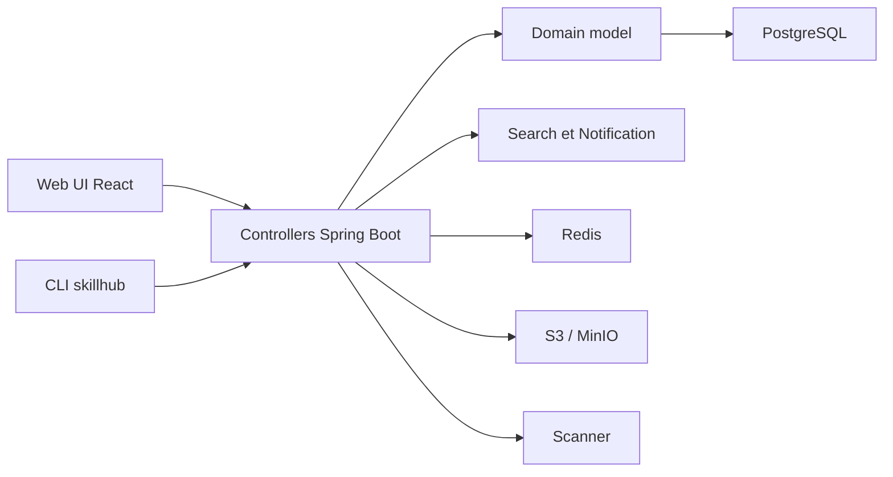

# iflytek/skillhub

> Self-hosted registry to publish, govern and install agent skills within a team.

## The problem
Agent skills circulate through copy-paste or public repositories. An organization has no versioning, no access control and no review before distribution.

## What it actually does
Spring Boot server (Java 21) + React SPA. You publish a `SKILL.md` package with semantic versions and tags, then search in full text and install via CLI. Namespaces with roles, review by admins, audit log, stars and ratings. Local or S3/MinIO storage, PostgreSQL, Redis, a package security scanner, partial ClawHub compatibility.

## How it is wired


## Trying it
```bash
curl -fsSL https://imageless.oss-cn-beijing.aliyuncs.com/runtime.sh | sh -s -- up --public-url https://skillhub.your-company.com
npm install -g @astron-team/skillhub
skillhub search pdf
make dev-all
```

## Cost and gotchas
Docker Compose, even Kubernetes/Helm. The install script comes from an Aliyun OSS bucket, to be reviewed before `| sh`. Default admin password `ChangeMe!2026` must be changed.

## What it is not
Not a collection of skills but the infrastructure to host them. Publishing via the ClawHub protocol is not compatible.

## Alternatives
- anthropics/skills: complementary content collection, not a registry.

## For you
Worth watching: useful if your team shares many agent skills and wants a governed internal registry; for solo use, a Git repository is enough.
