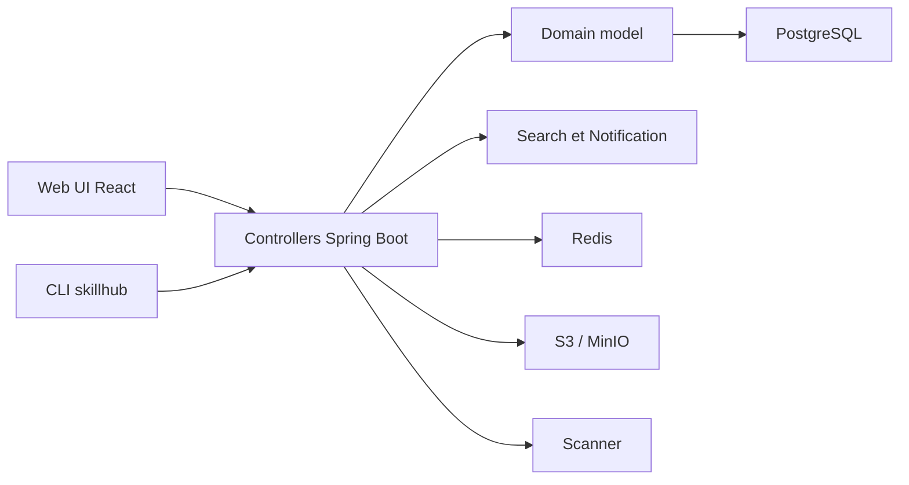

# iflytek/skillhub

> Registre auto-hébergé pour publier, gouverner et installer les skills d'agents au sein d'une équipe.

## Le problème
Les skills d'agents circulent par copier-coller ou dépôts publics. Une organisation n'a ni versionnage, ni contrôle d'accès, ni revue avant diffusion.

## Ce que ça fait vraiment
Serveur Spring Boot (Java 21) + SPA React. On publie un package `SKILL.md` avec versions sémantiques et tags, puis on cherche en plein texte et on installe par CLI. Espaces de noms avec rôles, revue par les admins, journal d'audit, étoiles et notes. Stockage local ou S3/MinIO, PostgreSQL, Redis, scanner de sécurité de packages, compatibilité ClawHub partielle.

## Comment c'est branché


## Essayer
```bash
curl -fsSL https://imageless.oss-cn-beijing.aliyuncs.com/runtime.sh | sh -s -- up --public-url https://skillhub.your-company.com
npm install -g @astron-team/skillhub
skillhub search pdf
make dev-all
```

## Coût et pièges
Docker Compose, voire Kubernetes/Helm. Le script d'installation vient d'un bucket OSS Aliyun, à relire avant `| sh`. Mot de passe admin par défaut `ChangeMe!2026` à changer.

## Ce que ce n'est pas
Pas une collection de skills mais l'infrastructure pour les héberger. La publication via le protocole ClawHub n'est pas compatible.

## Alternatives
- anthropics/skills : collection de contenu complémentaire, pas un registre.

## Pour toi
À surveiller : utile si ton équipe partage beaucoup de skills d'agents et veut un registre interne gouverné ; pour un usage solo, le dépôt Git suffit.

