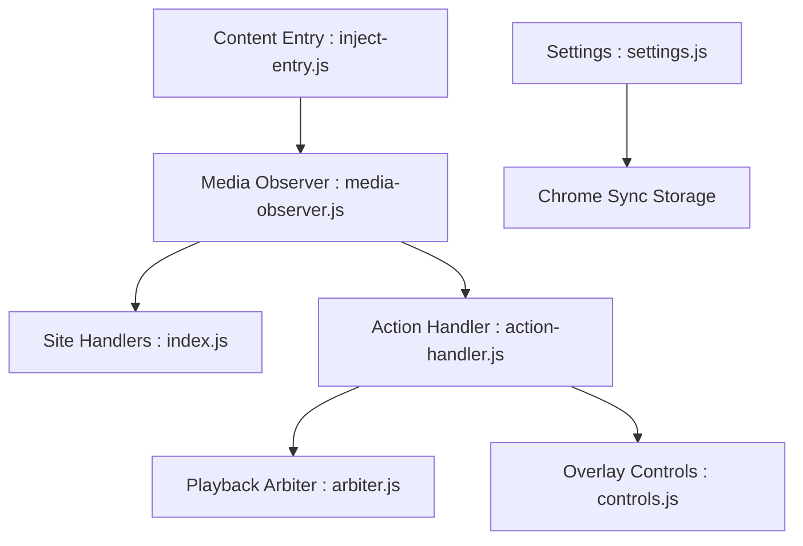

# igrigorik/videospeed

> Browser extension to finely adjust the playback speed of any HTML5 video or audio.

## The problem
Web players hide or limit playback speed adjustment.

## What it actually does
Detects media elements, attaches an overlay controller and keyboard shortcuts (S, D, R, Z, X, G, V, M, J). Speed from 0.07x to 16x, per-site rules, per-site disabling, speed memorization, speed restoration if the site resets it, customizable CSS. Specific handlers for YouTube and Netflix.

## How it is wired


## Trying it
```bash
# Aucune commande : installation depuis le Chrome Web Store (lien en tête du README).
```

## Cost and gotchas
Free. Settings are synced through Chrome storage. The page must be reloaded after a shortcut change.

## What it is not
Not a transcription or summarization tool: it only changes the speed. The README justifies accelerated listening with studies, which are not evaluated here.

## Alternatives
No alternative named in the README.

## For you
Worth watching: real time saved when watching ML courses and talks at speed, with no impact on your code.
