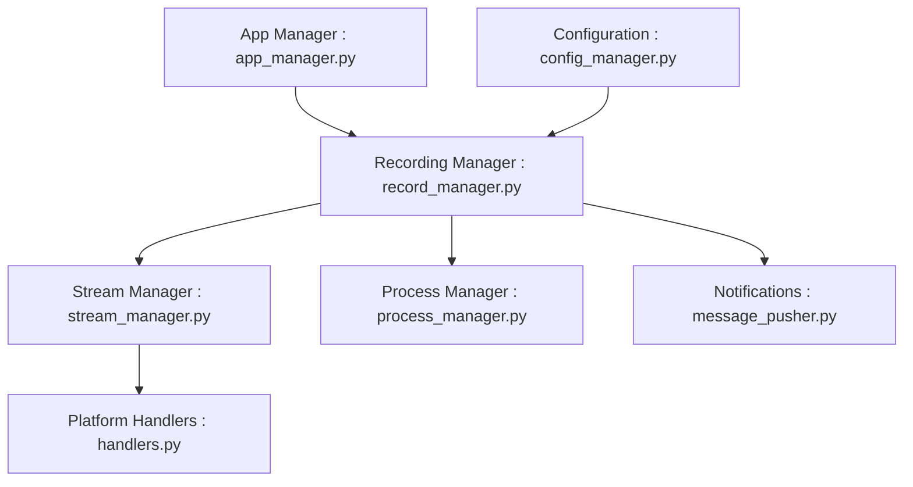

# ihmily/StreamCap

> Live stream recording client for more than 40 platforms, based on FFmpeg.

## The problem
Automatically recording live broadcasts as soon as they start.

## What it actually does
Monitors room status in a loop or on fixed schedules, starts recording when the live begins (batch possible), writes to ts, flv, mkv, mp4, mp3 or m4a, transcodes to mp4, sends notifications. Uses the streamget library and the Flet interface. Windows, macOS, web mode.

## How it is wired


## Trying it
```bash
git clone https://github.com/ihmily/StreamCap.git
cd StreamCap
pip install -i https://pypi.org/simple streamget
pip install -r requirements.txt
cp .env.example .env
python main.py
docker compose up
```

## Cost and gotchas
Free. Python 3.10+ and FFmpeg required. YouTube requires a cookie. 236 open issues. The right to record depends on each platform and the content.

## What it is not
Not a video analysis tool: it only records. README in Chinese, help sections in an external wiki.

## Alternatives
No alternative named in the README (it thanks flet, FFmpeg, streamget).

## For you
Ignore: useful for archiving live streams, but unrelated to data/AI; legal framework to be verified.
