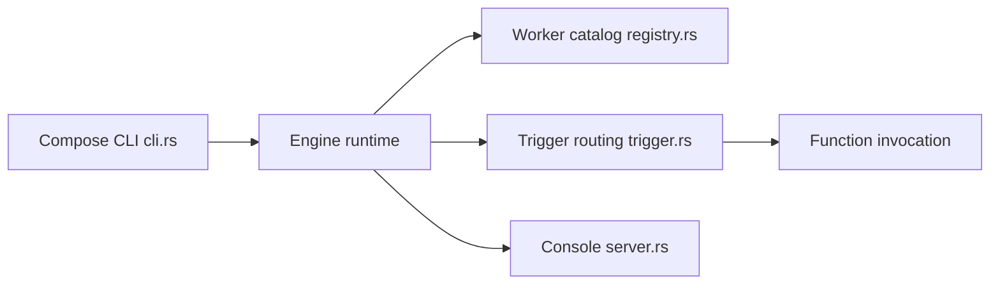

# iii-hq/iii

> Engine that links workers, triggers and functions, to compose and observe services and agents in real time.

## The problem
Queues, cron, HTTP, state, observability and agents each integrate in their own way, with separate traces and retries.

## What it actually does
Three primitives: workers (registered processes), triggers (direct call, HTTP, cron, queue, state, streams) and functions (stable identifier, e.g. `orders::validate`). The Rust engine maintains the live catalog, routes triggers and traces everything. Workers can be added live via `compose`. Node, Python, Rust and Go SDKs; skills for agents; developer console.

## How it is wired


## Trying it
```bash
curl -fsSL https://install.iii.dev/iii/main/install.sh | sh
iii compose --namespace dev --up
iii trigger -n dev compose::add worker=queue
```

## Cost and gotchas
Free on the repository side, but no license declared: usage rights not established. Remote installation script via `curl | sh`.

## What it is not
Not an agent framework: a service composition runtime. Several internal links unverified (sources not sampled).

## Alternatives
No alternative named in the README.

## For you
Interesting idea for orchestrating pipelines and agents, but young and unlicensed: watch before any use.
