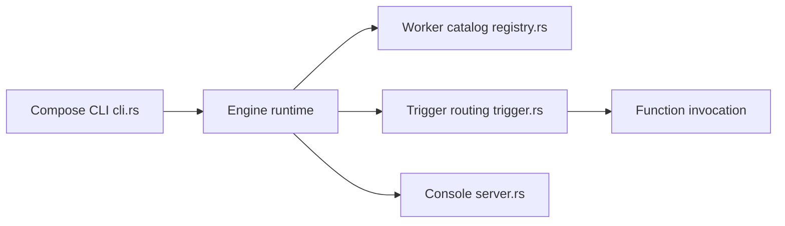

# iii-hq/iii

> Moteur qui relie workers, déclencheurs et fonctions, pour composer et observer services et agents en temps réel.

## Le problème
Files, cron, HTTP, état, observabilité et agents s'intègrent chacun à leur manière, avec traces et retries séparés.

## Ce que ça fait vraiment
Trois primitives : workers (processus enregistrés), triggers (appel direct, HTTP, cron, file, état, flux) et functions (identifiant stable, ex. `orders::validate`). Le moteur Rust tient le catalogue vivant, route les triggers et trace tout. Ajout de workers à chaud via `compose`. SDK Node, Python, Rust, Go ; skills pour agents ; console développeur.

## Comment c'est branché


## Essayer
```bash
curl -fsSL https://install.iii.dev/iii/main/install.sh | sh
iii compose --namespace dev --up
iii trigger -n dev compose::add worker=queue
```

## Coût et pièges
Gratuit côté dépôt, mais aucune licence déclarée : droits d'usage non établis. Script d'installation distant en `curl | sh`.

## Ce que ce n'est pas
Pas un framework d'agents : un runtime de composition de services. Plusieurs liens internes non vérifiés (sources non échantillonnées).

## Alternatives
Aucune alternative nommée dans le README.

## Pour toi
Idée intéressante pour orchestrer pipelines et agents, mais jeune et sans licence : à surveiller avant tout usage.

