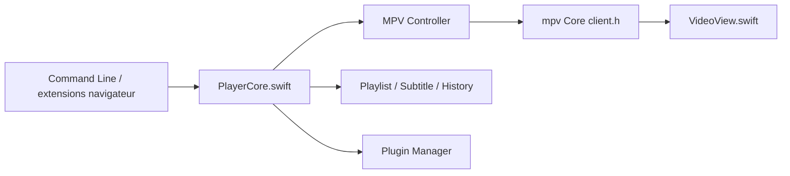

# iina/iina

> Modern video and music player for macOS 11+, built on mpv, for Mac users.

## The problem
Native macOS players read few formats, and mpv, very capable, offers no interface that fits Mac conventions.

## What it actually does
IINA dresses the mpv engine in a macOS interface: subtitles (online search and local matching), playlists, chapters, music mode, picture-in-picture, Touch Bar, history. mpv configuration files and scripts remain usable, and a JavaScript plugin system is added. A command line and Safari and Chrome extensions send a media URL to the player.

## How it is wired


## Trying it
```bash
./other/download_libs.sh
mkdir -p deps/executable
ln -s $(which yt-dlp) deps/executable/youtube-dl
```

## Cost and gotchas
Free. Building requires the latest public version of Xcode, otherwise the build may fail. Nightly builds are produced on every commit and may be unusable.

## What it is not
Neither cross-platform nor a video processing tool: it is a macOS-only player. It does not replace mpv, which it embeds.

## Alternatives
- mpv: the engine itself, on the command line, without a dedicated Mac interface.

## For you
Ignore: a macOS player does not fit into a data/AI/MLOps workflow, and its GPL-3.0 license matters only if you redistribute derived code.
