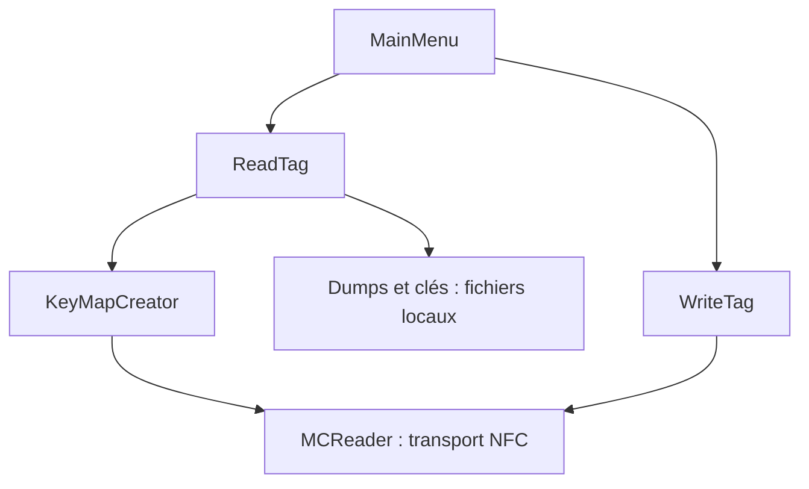

# ikarus23/MifareClassicTool

> Android NFC application to read, write and analyze MIFARE Classic RFID cards, for advanced users.

## The problem
Inspecting the contents of a MIFARE Classic card otherwise requires a dedicated reader and command-line tools.

## What it actually does
Reads a card using key files (dictionaries) and tries each key on each sector. It saves and edits dumps, writes block by block, clones (including block 0 of special "magic" cards), decodes value blocks and access conditions, and compares dumps. It does not crack any key and has no brute force.

## How it is wired

## Trying it
No documented command: the application is installed from Google Play, F-Droid or an APK; it is driven through its menus.

## Cost and gotchas
Free. You need an Android phone whose NFC controller supports MIFARE Classic; some chips do not. Keys have to come from elsewhere, and uninstalling the application deletes the dumps.

## What it is not
It is not a hacking tool: it does not crack keys. It does not write a URL through a simple interface: data is entered in hexadecimal.

## Alternatives
Proxmark3, mfcuk and mfoc, cited in the README for recovering keys.

## For you
Ignore: an RFID tool unrelated to data, AI or MLOps work.
