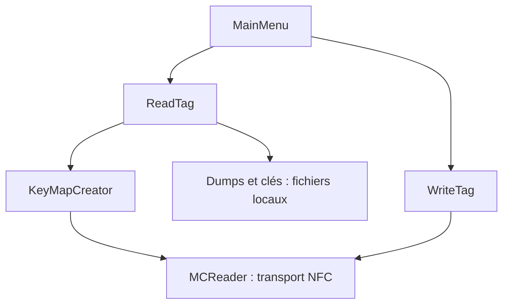

# ikarus23/MifareClassicTool

> Application Android NFC pour lire, écrire et analyser des cartes RFID MIFARE Classic, pour utilisateurs avertis.

## Le problème
Inspecter le contenu d'une carte MIFARE Classic demande sinon un lecteur dédié et des outils en ligne de commande.

## Ce que ça fait vraiment
Lit une carte avec des fichiers de clés (dictionnaires) et essaie chaque clé sur chaque secteur. Elle sauvegarde et édite les dumps, écrit bloc par bloc, clone (y compris le bloc 0 des cartes spéciales « magic »), décode les blocs de valeur et les conditions d'accès, compare des dumps. Elle ne casse aucune clé et n'a pas de force brute.

## Comment c'est branché

## Essayer
Aucune commande documentée : l'application s'installe depuis Google Play, F-Droid ou un APK ; elle se pilote par ses menus.

## Coût et pièges
Gratuit. Il faut un téléphone Android dont le contrôleur NFC gère MIFARE Classic ; certaines puces ne le font pas. Les clés doivent venir d'ailleurs, et désinstaller l'application supprime les dumps.

## Ce que ce n'est pas
Ce n'est pas un outil de piratage : il ne casse pas les clés. Il n'écrit pas d'URL par une interface simple : les données se saisissent en hexadécimal.

## Alternatives
Proxmark3, mfcuk et mfoc, cités dans le README pour récupérer les clés.

## Pour toi
À ignorer : outil de RFID sans rapport avec le travail data, IA ou MLOps.

