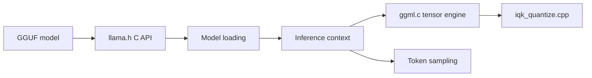

# ik_llama.cpp

> Fork of llama.cpp with extra quantizations and faster CPU and CUDA inference, for those who run LLMs locally.

## The problem
Running large models (MoE, DeepSeek) on modest CPUs or GPUs is slow and memory-hungry.

## What it actually does
Loads GGUF models and exposes an OpenAI-compatible server. Adds quantization types (IQK, trellis, ternary), MLA, FlashMLA, a multi-GPU "graph" split mode, MTP and speculative decoding, and tensor placement in VRAM. Only CPU (AVX2+, ARM_NEON) and CUDA (Turing+) are fully functional.

## How it is wired


## Trying it
```bash
git clone https://github.com/ikawrakow/ik_llama.cpp
cd ik_llama.cpp
cmake -B build -DGGML_NATIVE=ON
cmake --build build --config Release -j$(nproc)
./build/bin/llama-server --model /my_local_files/gguf/Qwen_Qwen3-0.6B-IQ4_NL.gguf --ctx-size 4096
```

## Cost and gotchas
GGUF models must be downloaded; do not use `-rtr` in CPU/GPU hybrid mode; avoid Unsloth `_XL` models with f16 tensors. No ROCm, Vulkan or Metal support.

## What it is not
Not synchronized with llama.cpp (last sync August 2024). No single documentation: you have to read the PRs.

## Alternatives
- llama.cpp: the main version, with more backends.

## For you
Adopt if you do local inference on CPU/CUDA and want to save memory; keep in mind the single main maintainer and the limited backends.
