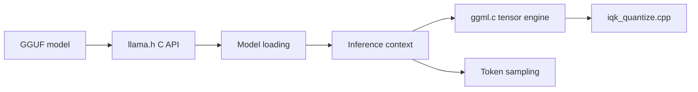

# ik_llama.cpp

> Fork de llama.cpp aux quantifications supplémentaires et à l'inférence CPU et CUDA plus rapide, pour qui exécute des LLM en local.

## Le problème
Faire tourner de gros modèles (MoE, DeepSeek) sur CPU ou GPU modestes est lent et gourmand en mémoire.

## Ce que ça fait vraiment
Charge des modèles GGUF et expose un serveur compatible OpenAI. Ajoute des types de quantification (IQK, trellis, ternaires), MLA, FlashMLA, split mode « graph » multi-GPU, décodage MTP et spéculatif, placement des tenseurs en VRAM. Seuls CPU (AVX2+, ARM_NEON) et CUDA (Turing+) sont pleinement fonctionnels.

## Comment c'est branché


## Essayer
```bash
git clone https://github.com/ikawrakow/ik_llama.cpp
cd ik_llama.cpp
cmake -B build -DGGML_NATIVE=ON
cmake --build build --config Release -j$(nproc)
./build/bin/llama-server --model /my_local_files/gguf/Qwen_Qwen3-0.6B-IQ4_NL.gguf --ctx-size 4096
```

## Coût et pièges
Modèles GGUF à télécharger ; ne pas utiliser `-rtr` en hybride CPU/GPU ; éviter les modèles Unsloth `_XL` avec des tenseurs f16. Pas de support ROCm, Vulkan ni Metal.

## Ce que ce n'est pas
Pas synchronisé avec llama.cpp (dernière synchronisation août 2024). Pas de documentation unique : il faut lire les PR.

## Alternatives
- llama.cpp : version principale, plus de backends.

## Pour toi
À adopter si tu fais de l'inférence locale sur CPU/CUDA et veux économiser de la mémoire ; réserve pour un mainteneur principal et des backends limités.

