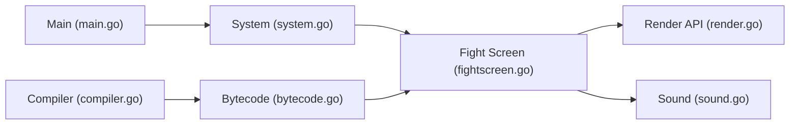

# ikemen-engine/Ikemen-GO

> Open-source fighting game engine written in Go, compatible with M.U.G.E.N resources.

## The problem
M.U.G.E.N is closed and aging; creators of characters and stages want a maintained, extensible engine.

## What it actually does
Interprets game content (`.cmd`, `.air`, `.cns`, `.zss`) compiled to bytecode, with deterministic simulation, rollback and online play. Rendering via OpenGL 3.3, OpenGL ES 3.2 or Vulkan, SDL audio, FFmpeg video, Lua scripted interface. Aims for compatibility with M.U.G.E.N 1.1 Beta without copying its bugs. Windows, macOS (Apple Silicon), Linux, Android. The README says the engine is under MIT, but GitHub does not identify the file: to be checked.

## How it is wired


## Trying it
```bash
# Windows : double-cliquer Ikemen_GO.exe
# macOS / Linux : double-cliquer Ikemen_GO.command
```
To build, the README points to BUILDING.md.

## Cost and gotchas
Free; GPU compatible with OpenGL 3.3, GLES 3.2 or Vulkan. No more support for Windows 7/8 or Intel macOS. The default motif is under CC-BY 3.

## What it is not
Not a ready-to-play game: it needs characters and stages supplied by the community.

## Alternatives
No named alternative (M.U.G.E.N is the emulated engine, and the original Ikemen repository is cited).

## For you
Ignore: a fighting game engine unrelated to data, AI or MLOps.
