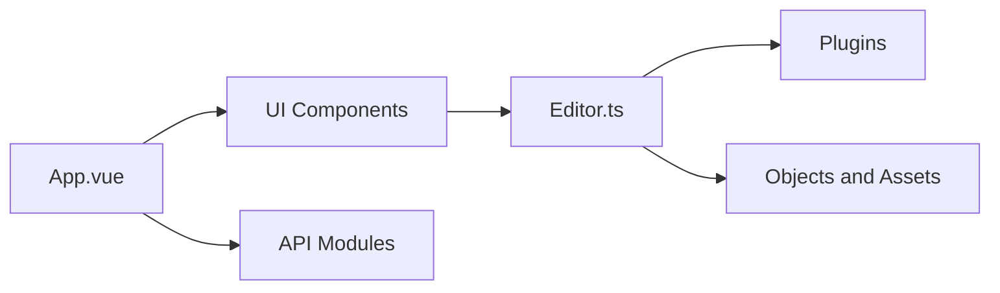

# ikuaitu/vue-fabric-editor

> Plugin-based web image editor in Vue and fabric.js, for embedding a design tool.

## The problem
Offer users an in-browser image editor without starting from scratch on the canvas.

## What it actually does
Vue interface (`src/`) on top of a `packages/core` core (`Editor.ts`, `Instance.ts`) and plugins: history, alignment guides, cropping, fonts, PSD/JSON import, PNG/SVG/JSON export, QR codes, filters, watermark. The open source version is front-end only; a full back-end is sold.

## How it is wired


## Trying it
```bash
npm install -g pnpm@8.4.0
pnpm i
pnpm dev
```

## Cost and gotchas
Node 18–20 and pnpm 8.x are mandatory (higher versions break, according to the README). Paid version for back-end and admin. README is mostly in Chinese.

## What it is not
Not an online Photoshop: the author claims it is lightweight. No back-end in the free version.

## Alternatives
No alternative named in the README; fabric.js is the underlying library.

## For you
Ignore: no link with data/AI, and most of the commercial value is in a paid version.
