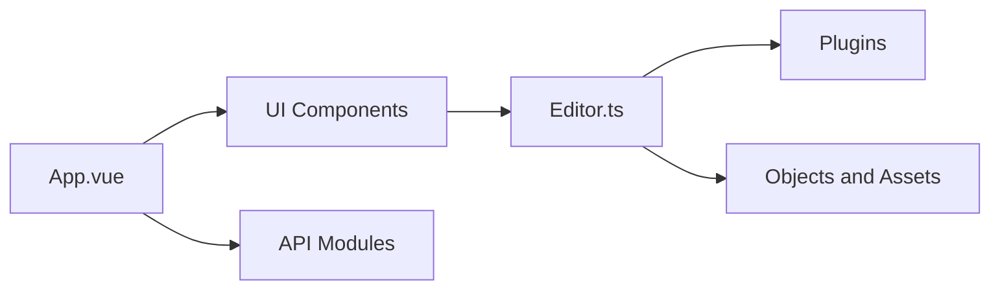

# ikuaitu/vue-fabric-editor

> Éditeur d'images web en Vue et fabric.js, à plugins, pour intégrer un outil de design.

## Le problème
Offrir à des utilisateurs un éditeur d'images dans le navigateur sans repartir de zéro sur le canvas.

## Ce que ça fait vraiment
Interface Vue (`src/`) au-dessus d'un cœur `packages/core` (`Editor.ts`, `Instance.ts`) et de plugins : historique, guides d'alignement, rognage, polices, import PSD/JSON, export PNG/SVG/JSON, QR codes, filtres, filigrane. La version open source est front-end seulement ; un back-end complet est vendu.

## Comment c'est branché


## Essayer
```bash
npm install -g pnpm@8.4.0
pnpm i
pnpm dev
```

## Coût et pièges
Node 18–20 et pnpm 8.x obligatoires (versions supérieures cassent selon le README). Version payante pour back-end et admin. README essentiellement en chinois.

## Ce que ce n'est pas
Pas un Photoshop en ligne : l'auteur le revendique léger. Pas de back-end dans la version libre.

## Alternatives
Aucune alternative nommée dans le README ; fabric.js est la bibliothèque sous-jacente.

## Pour toi
À ignorer : aucun lien avec data/IA, et l'essentiel de la valeur commerciale est dans une version payante.

