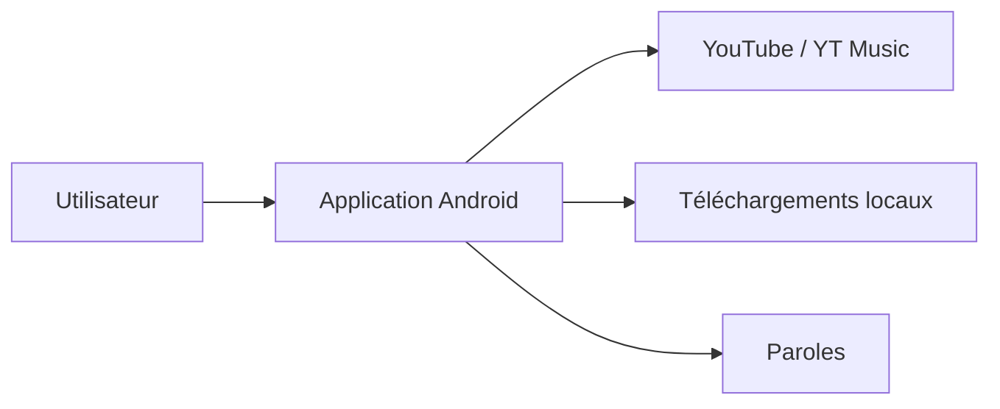

# ilianoKokoro/umihi-music

> Lightweight YouTube Music player for Android, in Kotlin and Jetpack Compose, for music lovers.

## The problem
The official YouTube Music client is heavy and ad-filled for someone who just wants to listen and download.

## What it actually does
Android application: playback of YouTube / YT Music playlists, lyrics, playlist creation, offline downloads, sleep timer, Android Auto, brand account sign-in. Search and playback are possible without signing in. A "store" version without built-in updates exists for F-Droid.

## How it is wired
Simplified diagram based on the sheet, no diagram provided.

## Trying it
No command documented: the README points to downloading the APK from GitHub or F-Droid.

## Cost and gotchas
Free, ad-free. Depends on the YouTube service, outside its control. The option to send data to Google for recommendations is optional.

## What it is not
Not a tool for data or AI. Age-restricted or private tracks cannot be played. Radio and recommendations are still under development.

## Alternatives
No alternative named in the README.

## For you
Ignore: a consumer application unrelated to your data, AI or MLOps profile.
