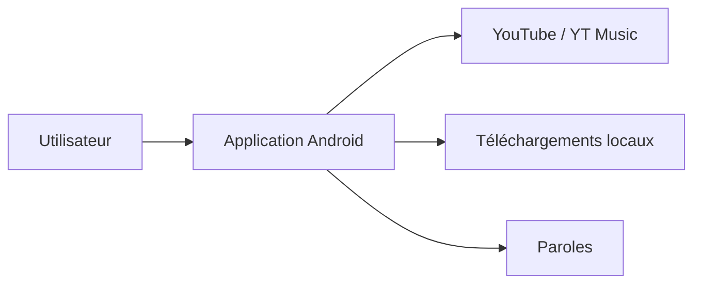

# ilianoKokoro/umihi-music

> Lecteur YouTube Music léger pour Android, en Kotlin et Jetpack Compose, pour mélomanes.

## Le problème
Le client officiel de YouTube Music est lourd et publicitaire pour qui veut juste écouter et télécharger.

## Ce que ça fait vraiment
Application Android : lecture de playlists YouTube / YT Music, paroles, création de playlists, téléchargements hors ligne, minuteur de sommeil, Android Auto, connexion de comptes de marque. Recherche et lecture possibles sans connexion. Une version « store » sans mise à jour intégrée existe pour F-Droid.

## Comment c'est branché
Schéma simplifié d'après la fiche, sans diagramme fourni.

## Essayer
Aucune commande documentée : le README renvoie au téléchargement de l'APK depuis GitHub ou F-Droid.

## Coût et pièges
Gratuit, sans publicité. Dépend du service YouTube, hors de son contrôle. L'option d'envoi de données à Google pour les recommandations est facultative.

## Ce que ce n'est pas
Ce n'est pas un outil pour data ou IA. Les titres restreints par l'âge ou privés ne sont pas lisibles. La radio et les recommandations sont encore en développement.

## Alternatives
Aucune alternative nommée dans le README.

## Pour toi
À ignorer : application grand public sans rapport avec ton profil data, IA ou MLOps.

