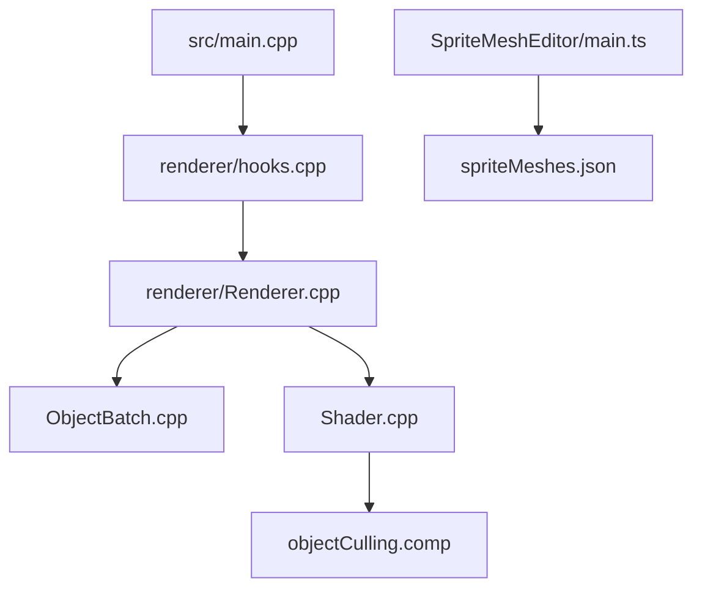

# iliasHDZ/Bismuth

> C++ mod that rewrites Geometry Dash rendering for better performance, still experimental.

## The problem
Geometry Dash's native rendering performs poorly.

## What it actually does
Based on the code, the mod hooks rendering through `hooks.cpp` and redirects it to `Renderer`, which batches objects and runs compute and draw shaders. A `SpriteMeshEditor` editor produces `spriteMeshes.json`. The README says nothing more.

## How it is wired
Diagram based on the code.



## Trying it
```bash
# Aucune commande documentée : builds de test sur le serveur Discord du projet
```

## Cost and gotchas
Free. You need the Geometry Dash game and a compatible GPU. C++ build is not documented.

## What it is not
Not stable: the README says "experimental". A game mod, outside any professional use.

## Alternatives
None mentioned in the README.

## For you
Ignore: video game mod unrelated to a data / AI / MLOps profile.
