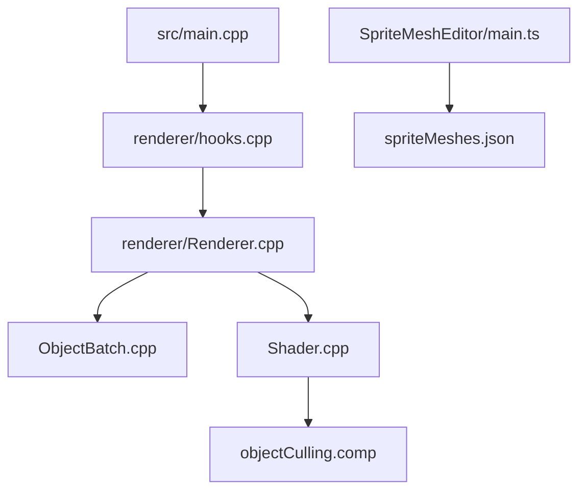

# iliasHDZ/Bismuth

> Mod C++ qui réécrit le rendu de Geometry Dash pour de meilleures performances, encore expérimental.

## Le problème
Le rendu natif de Geometry Dash est peu performant.

## Ce que ça fait vraiment
D'après le code, le mod accroche le rendu par `hooks.cpp` et le redirige vers `Renderer`, qui groupe les objets et exécute des shaders de calcul et de dessin. Un éditeur `SpriteMeshEditor` produit `spriteMeshes.json`. Le README ne dit rien de plus.

## Comment c'est branché
Schéma d'après le diagramme du code.



## Essayer
```bash
# Aucune commande documentée : builds de test sur le serveur Discord du projet
```

## Coût et pièges
Gratuit. Il faut le jeu Geometry Dash et un GPU compatible. Compilation C++ non documentée.

## Ce que ce n'est pas
Pas stable : le README indique « expérimental ». Mod de jeu, hors de tout usage professionnel.

## Alternatives
Aucune citée dans le README.

## Pour toi
Ignorer : mod de jeu vidéo sans lien avec un profil data / IA / MLOps.

