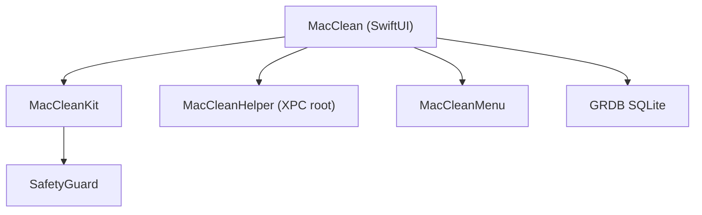

# iliyami/MacSai

> Free and open-source cleaner, optimizer and malware detector for macOS, an alternative to CleanMyMac.

## The problem
Mac cleaners are paid and closed, yet they require deep access to the user's files.

## What it actually does
22 modules: cleaning (caches, logs, project folders, Docker, simulators), protection (malware scanning with XProtect signatures, browser privacy), performance (login items, maintenance), applications (uninstaller, updates), files (treemap, duplicates, shredder) and a menu-bar widget. Deletion goes through the Trash first, with a list of protected paths and a privileged XPC helper. No telemetry declared; updates via Sparkle.

## How it is wired


## Trying it
```bash
brew install --cask mac-sai
swift build
swift test
```

## Cost and gotchas
Free, macOS 14 or later. Some modules require full disk access; building requires the Swift 6 toolchain (Xcode 16+). An install script is run via `curl | bash`.

## What it is not
Not an antivirus (it says so); malware detection is limited to signatures. Mac only.

## Alternatives
Pearcleaner: targeted uninstaller. PureMac: free MIT cleaner. Mole: command-line tool.

## For you
Ignore: Mac maintenance utility, unrelated to data/AI/MLOps work.
