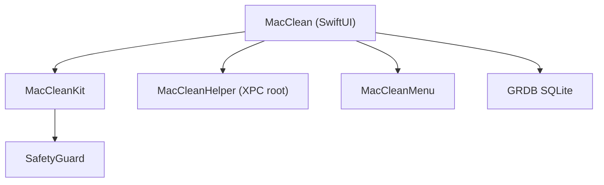

# iliyami/MacSai

> Nettoyeur, optimiseur et détecteur de logiciels malveillants libre pour macOS, alternative à CleanMyMac.

## Le problème
Les nettoyeurs de Mac sont payants et fermés, alors qu'ils demandent un accès profond aux fichiers de l'utilisateur.

## Ce que ça fait vraiment
22 modules : nettoyage (caches, journaux, dossiers de projet, Docker, simulateurs), protection (recherche de malwares par signatures XProtect, vie privée des navigateurs), performance (éléments de connexion, maintenance), applications (désinstalleur, mises à jour), fichiers (treemap, doublons, destructeur) et widget de barre de menus. Suppression par la Corbeille d'abord, liste de chemins protégés, helper XPC privilégié. Aucune télémétrie déclarée ; mises à jour via Sparkle.

## Comment c'est branché


## Essayer
```bash
brew install --cask mac-sai
swift build
swift test
```

## Coût et pièges
Gratuit, macOS 14 ou plus. Certains modules exigent l'accès complet au disque ; la compilation demande la chaîne Swift 6 (Xcode 16+). Un script d'installation se lance par `curl | bash`.

## Ce que ce n'est pas
Pas un antivirus (il le dit) ; la détection de malwares se limite à des signatures. Mac uniquement.

## Alternatives
Pearcleaner : désinstalleur ciblé. PureMac : nettoyeur libre MIT. Mole : outil en ligne de commande.

## Pour toi
À ignorer : utilitaire de maintenance Mac, sans lien avec le travail data/IA/MLOps.

