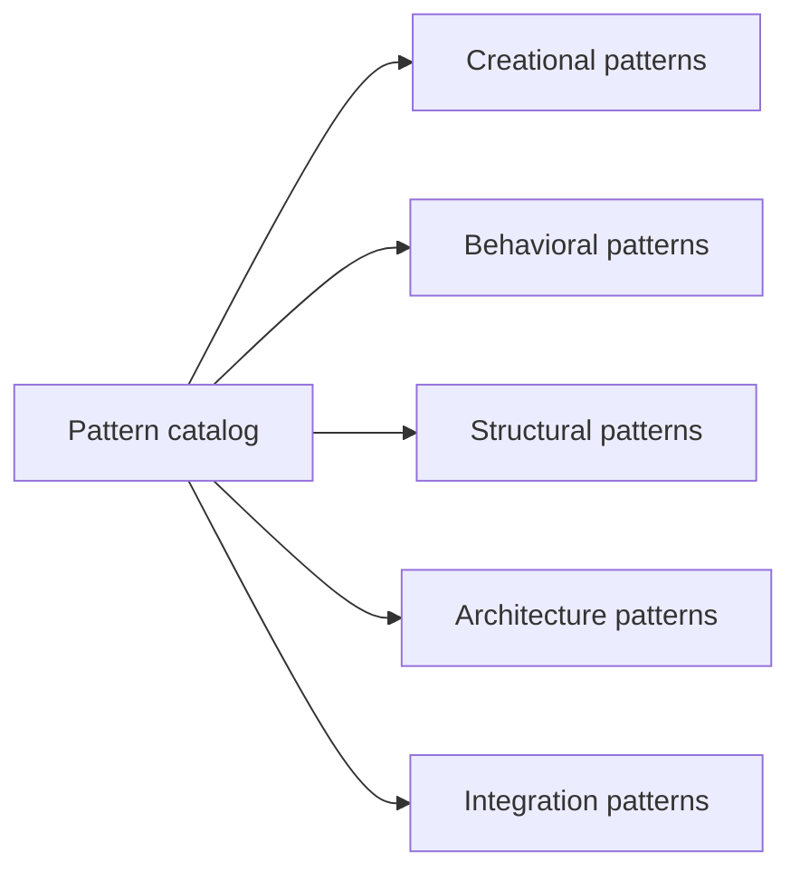

# iluwatar/java-design-patterns

> Catalogue of example design patterns in Java, with descriptions and commented code.

## The problem
The design patterns remain abstract, lacking concrete and organized code examples.

## What it actually does
A collection of independent examples, categorized by family: creational (abstract factory, builder), behavioral (command, rule engine), structural (dynamic proxy, adapter), architectural (CQRS, BFF, shopping cart) and integration (outbox, idempotent requests). You can search by name, label, or category. There is no shared runtime. A paid book is available.

## How it is wired


## Trying it
```bash
# aucune commande documentée : consulter le site et le code source des exemples
```

## Cost and gotchas
Free to read. The ebook is for sale. The license is not identified by GitHub.

## What it is not
Not a library to import. Not a course on AI or data.

## Alternatives
No alternative is specified in the README file.

## For you
Things to note: Java-centric frameworks offer little value to a data science or MLOps profile that primarily uses Python.
