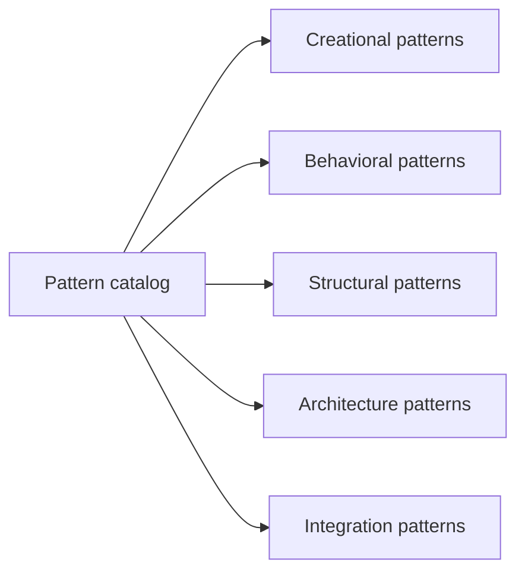

# iluwatar/java-design-patterns

> Catalogue d'exemples de patrons de conception en Java, avec descriptions et code commenté.

## Le problème
Les patrons de conception restent abstraits sans exemples de code concrets et organisés.

## Ce que ça fait vraiment
Un ensemble d'exemples indépendants classés par famille : créationnels (abstract factory, builder), comportementaux (command, rule engine), structurels (proxy dynamique, adapter), architecture (CQRS, BFF, panier) et intégration (outbox, requêtes idempotentes). On cherche par nom, étiquette ou catégorie. Pas de runtime commun. Un livre payant existe.

## Comment c'est branché


## Essayer
```bash
# aucune commande documentée : consulter le site et le code source des exemples
```

## Coût et pièges
Gratuit pour lire. Le livre électronique est vendu. La licence n'est pas identifiée par GitHub.

## Ce que ce n'est pas
Pas une bibliothèque à importer. Pas un cours sur l'IA ou la donnée.

## Alternatives
Aucune alternative nommée dans le README.

## Pour toi
À ignorer : les patrons orientés Java apportent peu à un profil data ou MLOps travaillant en Python.

