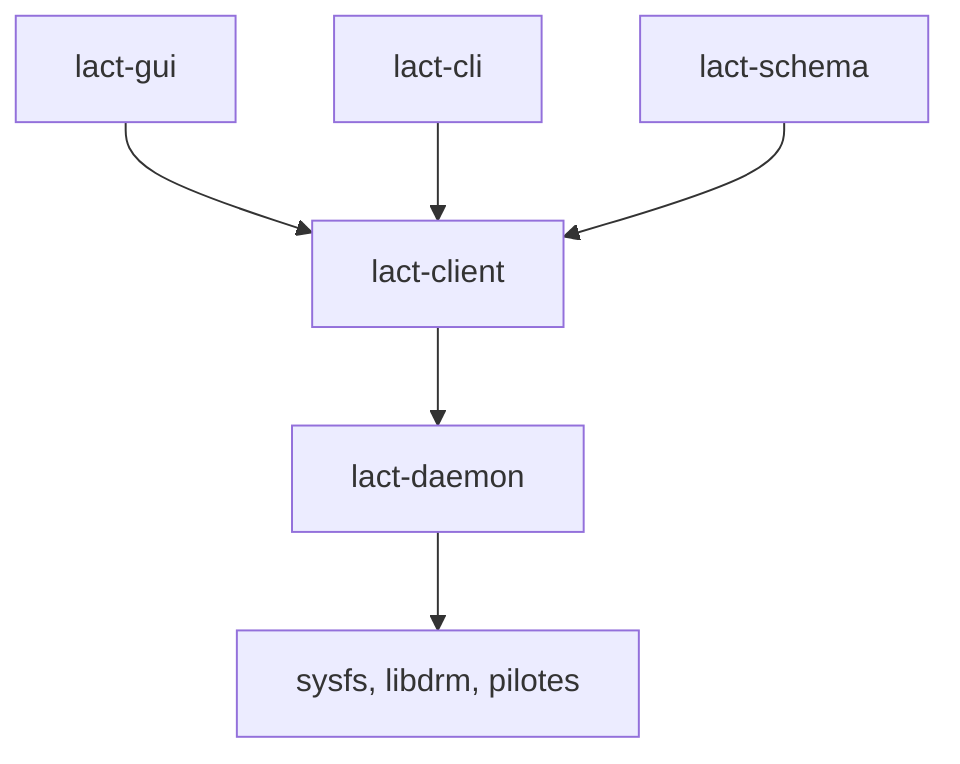

# ilya-zlobintsev/LACT

> Linux application to monitor and tune AMD, Nvidia and Intel GPUs: fans, power, overclocking.

## The problem
Tuning a GPU's fans, power limits and frequencies on Linux means handling sysfs by hand, vendor by vendor.

## What it actually does
A system daemon (lactd) configures the GPU without a graphical session and listens on a Unix socket. The GTK4 interface and a CLI connect to it. Features: hardware info, history graphs with CSV export, fan curves, power cap, undervolting, profiles activated depending on the processes launched, OpenTelemetry metrics exporter.

## How it is wired


## Trying it
```bash
sudo systemctl enable --now lactd
lact cli list-gpus
lact cli info
```

## Cost and gotchas
Free. Nvidia requires the proprietary driver with the CUDA libraries. The daemon must be running, otherwise no setting applies. The wheel or sudo group controls the socket: to be set up on OpenSUSE.

## What it is not
Not a benchmarking tool. Remote access over TCP has no authentication or encryption: trusted network only. Bad overclocking may require the recovery procedure.

## Alternatives
CoreCtrl: direct alternative, Qt interface, also handles the CPU. amdgpu_top: detailed AMD statistics. Tuxclocker: Qt overclocking tool.

## For you
Keep an eye on it: handy for capping power and temperature on a GPU machine under Linux, with no value outside that case.
