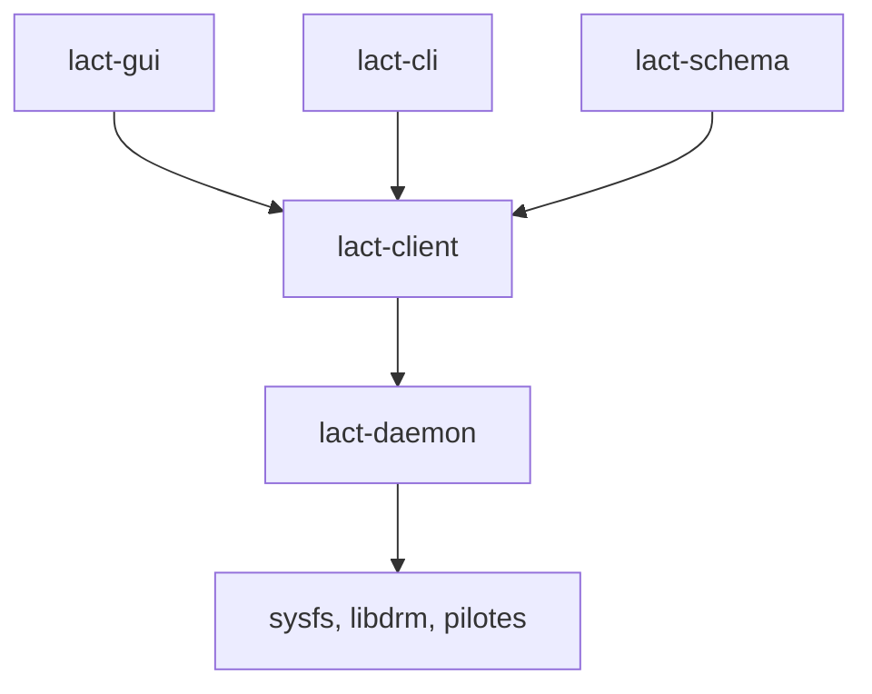

# ilya-zlobintsev/LACT

> Application Linux pour surveiller et régler les GPU AMD, Nvidia et Intel : ventilateurs, énergie, overclocking.

## Le problème
Régler ventilateurs, limites de puissance et fréquences d'un GPU sous Linux oblige à manipuler sysfs à la main, par fabricant.

## Ce que ça fait vraiment
Un démon système (lactd) configure le GPU sans session graphique et écoute sur un socket Unix. L'interface GTK4 et une CLI s'y connectent. Fonctions : infos matérielles, graphiques d'historique avec export CSV, courbes de ventilateur, plafond de puissance, sous-tension, profils activés selon les processus lancés, exportateur de métriques OpenTelemetry.

## Comment c'est branché


## Essayer
```bash
sudo systemctl enable --now lactd
lact cli list-gpus
lact cli info
```

## Coût et pièges
Gratuit. Nvidia exige le pilote propriétaire avec les bibliothèques CUDA. Le démon doit tourner, sinon aucun réglage. Le groupe wheel ou sudo contrôle le socket : à régler sur OpenSUSE.

## Ce que ce n'est pas
Pas un outil de benchmark. L'accès distant par TCP n'a ni authentification ni chiffrement : réseau de confiance seulement. Un mauvais overclocking peut nécessiter la procédure de récupération.

## Alternatives
CoreCtrl : alternative directe, interface Qt, gère aussi le CPU. amdgpu_top : statistiques AMD détaillées. Tuxclocker : outil Qt d'overclocking.

## Pour toi
À surveiller : pratique pour borner puissance et température d'une machine à GPU sous Linux, sans valeur hors de ce cas.

