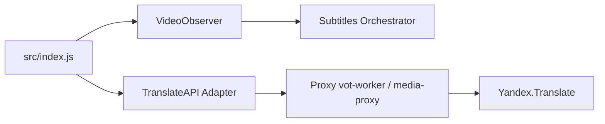

# ilyhalight/voice-over-translation

> Browser extension that translates online videos by voice, with subtitles.

## The problem
Following a video in a foreign language without reliable dubbing or subtitles.

## What it actually does
Injects an audio translation (Russian, English, Kazakh), subtitles that can be saved as `.srt`, `.vtt`, `.json`, the audio as `.mp3`, and separate volume sliders. Installs as a userscript (Tampermonkey) or as a Chrome/Firefox extension. Relies on Yandex's translation service, with third-party proxies.

## How it is wired


## Trying it
```bash
npm install
bun run autobuild
npm run build:gm
npm run build:ext
```

## Cost and gotchas
Free; depends on Yandex APIs and proxies, one of which does not work in Russia according to the README. Videos longer than 4 hours are not supported. README mostly in Russian.

## What it is not
Not a standalone translator: without Yandex's service, it produces nothing.

## Alternatives
vot-cli and vot.js, cited in the README.

## For you
Ignore: dependence on a third-party service and a Russian-speaking context, with no relevance to data/AI/MLOps.
