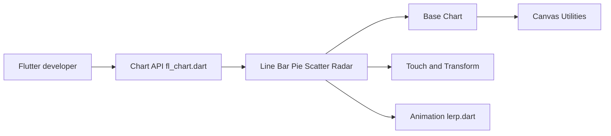

# imaNNeo/fl_chart

> Flutter library for customizable charts: lines, bars, pies, scatter plots, radar.

## The problem
Displaying interactive charts in a Flutter app without writing the canvas by hand.

## What it actually does
One widget per chart type (Line, Bar, Pie, Scatter, Radar, Candlestick), configured by a data object. Shared rendering core (`Base Chart`, `Axis Charts`, canvas utilities), touch gestures and animations (`lerp.dart`). Documentation and examples on flchart.dev.

## How it is wired

## Trying it
The README points to the installation guide on flchart.dev, with no command. Not documented here.

## Cost and gotchas
Free. Funded by donations. 390 open issues.

## What it is not
Not a data visualization tool for notebooks: it lives inside a Flutter mobile or desktop application.

## Alternatives
No alternative named in the README.

## For you
Ignore if you stay on Python; useful only for a Flutter front end that displays metrics.
