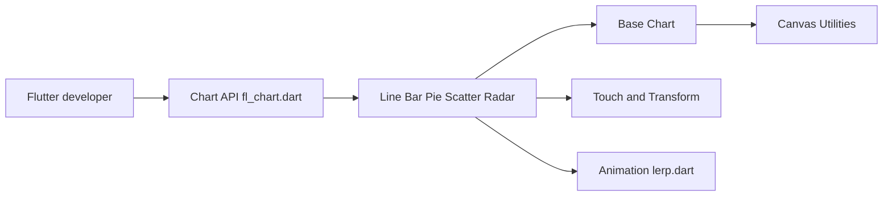

# imaNNeo/fl_chart

> Bibliothèque Flutter de graphiques personnalisables : lignes, barres, secteurs, nuages de points, radar.

## Le problème
Afficher des graphiques interactifs dans une appli Flutter sans écrire le canvas à la main.

## Ce que ça fait vraiment
Un widget par type de graphique (Line, Bar, Pie, Scatter, Radar, Candlestick) configuré par un objet de données. Cœur de rendu commun (`Base Chart`, `Axis Charts`, utilitaires canvas), gestes tactiles et animations (`lerp.dart`). Documentation et exemples sur flchart.dev.

## Comment c'est branché

## Essayer
Le README renvoie au guide d'installation sur flchart.dev, sans commande. Non documenté ici.

## Coût et pièges
Gratuit. Financement par dons. 390 issues ouvertes.

## Ce que ce n'est pas
Pas un outil de data visualisation pour notebooks : il vit dans une application mobile ou bureau Flutter.

## Alternatives
Aucune alternative nommée dans le README.

## Pour toi
À ignorer si tu restes sur Python ; utile uniquement pour un front Flutter qui affiche des métriques.

