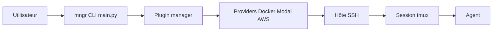

# imbue-ai/mngr

> Unix CLI to launch, list and drive local or remote coding agents, via SSH, git and tmux.

## The problem
Managing dozens of coding agents across several machines without a proprietary cloud service is a patchwork.

## What it actually does
`mngr create` launches an agent (Claude, Codex, OpenCode...) in a tmux session on a local, Docker or Modal host; `list`, `connect`, `message`, `transcript`, `exec`, `snapshot`, `clone`, `migrate`, `push/pull`, `pair`. Hosts pause when agents are idle. Plugins for providers (AWS, Azure, GCP). Mirror repository of Imbue's internal repository.

## How it is wired


## Trying it
```bash
curl -fsSL https://raw.githubusercontent.com/imbue-ai/mngr/main/scripts/install.sh | bash
mngr create my-task codex
mngr list
mngr transcript agent-1
```

## Cost and gotchas
The CLI is free; inference and remote compute (Modal, etc.) are at your expense. Requires git, tmux, jq. 238 open issues; `snapshot` and `plugin` are experimental.

## What it is not
Not an agent nor a model: an orchestrator. License not identified by GitHub.

## Alternatives
No alternative cited in the README.

## For you
Worth watching: handy for launching agents in parallel on remote compute, after confirming the license.
