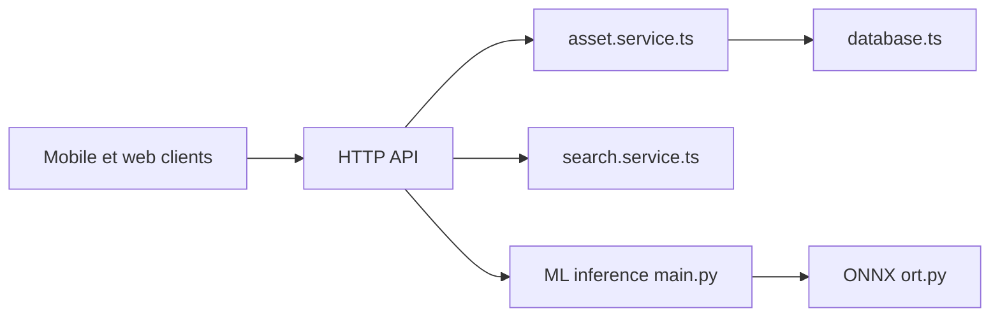

# immich-app/immich

> Self-hosted photo and video manager with AI search, for individuals and families.

## The problem
Photos stored with a large provider escape your control and your budget.

## What it actually does
The mobile and web applications upload media to the server, which stores files and metadata. A machine learning service provides CLIP embeddings for search, face detection and OCR, via ONNX sessions. Shared albums, memories, map, partners, OAuth and API keys are listed. The README points to the documentation site for installation.

## How it is wired


## Trying it
```bash
# aucune commande dans le README : installation décrite sur https://immich.app/
```

## Cost and gotchas
Free, self-hosted: storage and backup are your responsibility (the README recalls the 3-2-1 rule). The machine learning service consumes RAM.

## What it is not
Not a backup solution by itself. AGPL-3.0: beware if you deploy a modified version for third parties.

## Alternatives
No alternative named in the README.

## For you
Adopt for personal use: a concrete case of CLIP, faces and an ML pipeline served in containers, instructive for MLOps.
