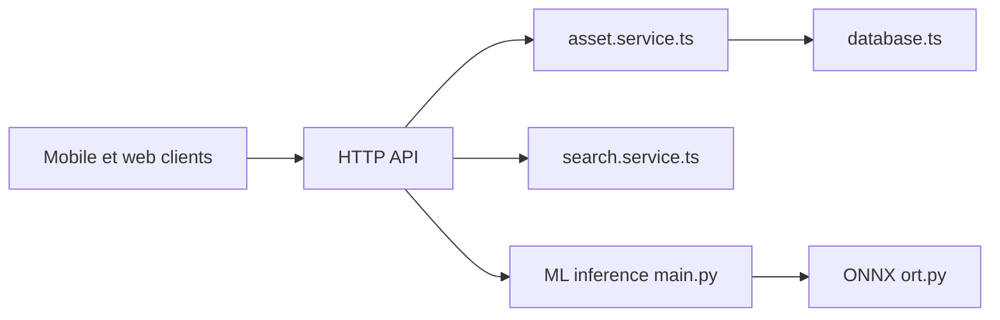

# immich-app/immich

> Gestionnaire de photos et vidéos auto-hébergé, avec recherche IA, pour particuliers et familles.

## Le problème
Les photos stockées chez un grand fournisseur échappent à ton contrôle et à ton budget.

## Ce que ça fait vraiment
Les applications mobile et web envoient les médias au serveur, qui stocke fichiers et métadonnées. Un service d'apprentissage automatique fournit les embeddings CLIP pour la recherche, la détection de visages et l'OCR, via des sessions ONNX. Albums partagés, mémoires, carte, partenaires, OAuth et clés d'API sont listés. Le README renvoie l'installation au site de documentation.

## Comment c'est branché


## Essayer
```bash
# aucune commande dans le README : installation décrite sur https://immich.app/
```

## Coût et pièges
Gratuit, auto-hébergé : stockage et sauvegarde à ta charge (le README rappelle la règle 3-2-1). Le service d'apprentissage consomme de la RAM.

## Ce que ce n'est pas
Pas une solution de sauvegarde à lui seul. AGPL-3.0 : attention en cas de modification déployée pour des tiers.

## Alternatives
Aucune alternative nommée dans le README.

## Pour toi
À adopter à titre perso : cas concret de CLIP, de visages et de pipeline ML servi en conteneurs, instructif pour du MLOps.

