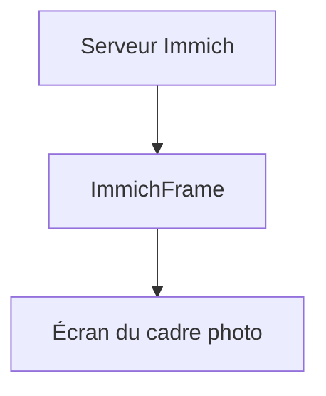

# immichFrame/ImmichFrame

> Digital photo frame that displays the photos of an Immich gallery.

## The problem
Photos stored in Immich stay inside the application, with no simple way to display them continuously on a screen.

## What it actually does
According to the very short README: a photo-frame style display for your photos. The text points to external documentation and an external demo; no feature, command or architecture is described. The project states that it is not affiliated with Immich.

## How it is wired
Simplified diagram based on the fiche, no diagram provided.

## Trying it
Not documented in the README: installation is described on the external documentation site.

## Cost and gotchas
Assumes an Immich server is already in place. The deployment mode is not specified in the README. Help is available through a Discord channel.

## What it is not
Not a product of the Immich team. Not a photo gallery on its own: it depends on Immich for the images.

## Alternatives
None cited in the README.

## For you
Ignore: unrelated to data or AI, and the README gives too little material to judge anything beyond home use.
