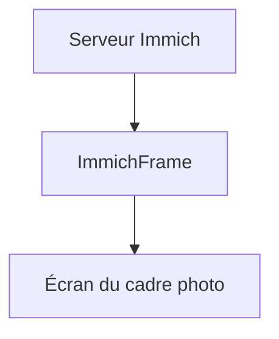

# immichFrame/ImmichFrame

> Cadre photo numérique qui affiche les photos d'une galerie Immich.

## Le problème
Les photos stockées dans Immich restent dans l'application, sans moyen simple de les afficher en continu sur un écran.

## Ce que ça fait vraiment
D'après le README, très court : un affichage de type cadre photo pour tes photos. Le texte renvoie à une documentation et à une démo externes ; aucune fonction, commande ou architecture n'y est décrite. Le projet précise qu'il n'est pas affilié à Immich.

## Comment c'est branché
Schéma simplifié d'après la fiche, sans diagramme fourni.

## Essayer
Non documenté dans le README : l'installation est décrite sur le site de documentation externe.

## Coût et pièges
Suppose un serveur Immich déjà en place. Le mode de déploiement n'est pas précisé dans le README. Aide via un canal Discord.

## Ce que ce n'est pas
Pas un produit de l'équipe Immich. Pas une galerie photo à lui seul : il dépend d'Immich pour les images.

## Alternatives
Aucune citée dans le README.

## Pour toi
À ignorer : sans rapport avec la data ou l'IA, et le README ne donne pas assez de matière pour juger autre chose qu'un usage domestique.

