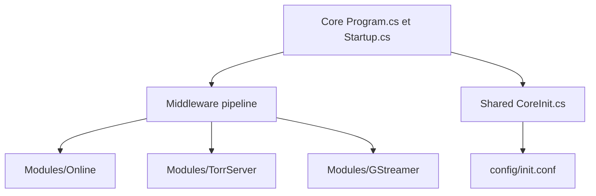

# immisterio/Lampac

> Self-hosted server that aggregates video content links from more than 70 sources for the Lampa application.

## The problem
The Lampa application displays movie sheets without providing the playback links itself; this server collects them.

## What it actually does
ASP.NET Core backend on port 9118, with hot-loaded modules: VOD providers, anime, TorrServer, DLNA, JacRed, GStreamer and FFmpeg transcoding, synchronization, Telegram notifications, Playwright to get around JavaScript protections, WAF firewall. The documentation is in Russian.

## How it is wired


## Trying it
```bash
git clone https://github.com/lampac-nextgen/lampac.git
cd lampac
mkdir -p lampac-docker/config lampac-docker/plugins
cp config/example.init.conf lampac-docker/config/init.conf
docker compose up -d
curl -fsS "http://localhost:9118/version?type=hash"
```

## Cost and gotchas
Docker, or .NET 10 natively. The DLNA, Tracks, Transcoding, GStreamer and Catalog modules do not filter requests: do not expose them without a firewall or authentication.

## What it is not
Not a video player: an aggregator of links to third-party content, including paid and adult sources. The legal status of the content is your responsibility.

## Alternatives
- No alternative named in the README (JacRed is described there as Jackett-compatible).

## For you
Ignore: a streaming server unrelated to data / AI / MLOps, and of dubious legal status.
