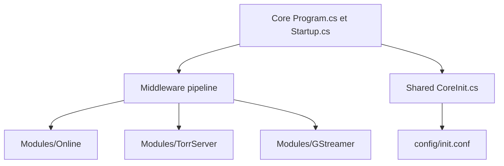

# immisterio/Lampac

> Serveur auto-hébergé qui agrège des liens de contenus vidéo de plus de 70 sources pour l'application Lampa.

## Le problème
L'application Lampa affiche des fiches de films sans fournir elle-même les liens de lecture ; ce serveur les collecte.

## Ce que ça fait vraiment
Backend ASP.NET Core sur le port 9118, avec modules chargés à chaud : fournisseurs VOD, anime, TorrServer, DLNA, JacRed, transcodage GStreamer et FFmpeg, synchronisation, notifications Telegram, Playwright pour contourner des protections JavaScript, pare-feu WAF. La documentation est en russe.

## Comment c'est branché


## Essayer
```bash
git clone https://github.com/lampac-nextgen/lampac.git
cd lampac
mkdir -p lampac-docker/config lampac-docker/plugins
cp config/example.init.conf lampac-docker/config/init.conf
docker compose up -d
curl -fsS "http://localhost:9118/version?type=hash"
```

## Coût et pièges
Docker, ou .NET 10 en natif. Les modules DLNA, Tracks, Transcoding, GStreamer et Catalog ne filtrent pas les requêtes : ne pas les exposer sans pare-feu ni authentification.

## Ce que ce n'est pas
Pas un lecteur vidéo : un agrégateur de liens vers du contenu tiers, dont des sources payantes et pour adultes. Statut juridique du contenu à ta charge.

## Alternatives
- Aucune alternative nommée dans le README (JacRed y est décrit comme compatible Jackett).

## Pour toi
Ignorer : un serveur de streaming sans rapport avec data / IA / MLOps, et au statut juridique douteux.

