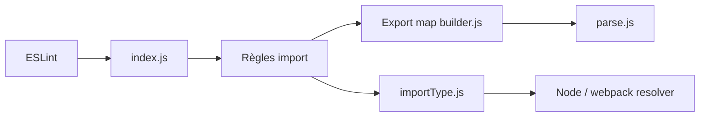

# import-js/eslint-plugin-import

> ESLint plugin that checks ES2015+ imports and exports and module paths.

## The problem
Path mistakes, bad named imports or dependency cycles are only seen at runtime.

## What it actually does
Provides rules: `no-unresolved`, `named`, `default`, `namespace`, `no-cycle`, `order`, `no-unused-modules`, etc. It builds a map of each module's exports (parsing is cached) and resolves paths through resolvers (Node, webpack, TypeScript). Compatible with both the legacy `.eslintrc` configuration and the flat `eslint.config.js`.

## How it is wired


## Trying it
```bash
npm install eslint-plugin-import --save-dev
```

## Cost and gotchas
Free. All rules are disabled by default. For TypeScript, install `@typescript-eslint/parser` and `eslint-import-resolver-typescript`. 581 open issues.

## What it is not
Not a bundler or a formatter. It does not check typing. Sublime support has documented quirks.

## Alternatives
No alternative named in the README.

## For you
Ignore: JavaScript lint tool unrelated to data/AI; relevant only if you maintain a JS/TS front end.
