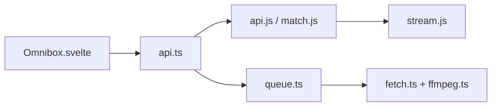

# imputnet/cobalt

> Web media downloader, ad-free and without tracking: simply copy and paste a link, and the file will be downloaded.

## The problem
Video download sites are often filled with advertisements, scams, and tracking software.

## What it actually does
A monorepo: an API that resolves public links to many services and returns a download or stream (a proxy without caching), and a Svelte web interface. Local processing (fetch + FFmpeg) runs in browser-side workers. The instance can be self-hosted.

## How it is wired

## Trying it
The README does not provide a command; instead, it refers to the documentation located in the `docs/` directory (launching and securing an instance, environment variables, API). There is nothing invented here.

## Cost and gotchas
Free; the hosting provider supports the bandwidth. The README specifies that the user is responsible for what they download. AGPL-3.0 license: obligations apply if you expose a modified service.

## What it is not
According to the author, it is not a hacking tool; it only contains publicly available content. It is not a media library manager.

## Alternatives
No alternative is specified in the README.

## For you
Monitoring: A useful tool for capturing recordings of presentations or demonstrations; however, it has no direct connection to data or AI work, and the AGPL license applies if you modify it.
