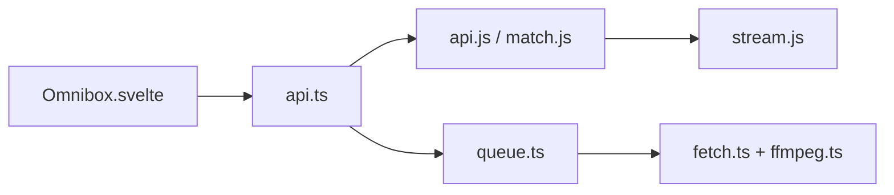

# imputnet/cobalt

> Téléchargeur de médias web sans pub ni traceur : colle un lien, récupère le fichier.

## Le problème
Les sites de téléchargement de vidéos sont saturés de publicité, de pièges et de traceurs.

## Ce que ça fait vraiment
Un monorepo : une API qui résout les liens publics de nombreux services et renvoie un téléchargement ou un flux (proxy sans cache), et une interface web Svelte. Le traitement local (fetch + FFmpeg) tourne dans des workers côté navigateur. Une instance peut être auto-hébergée.

## Comment c'est branché

## Essayer
Le README ne donne pas de commande : il renvoie à la doc `docs/` (lancer et protéger une instance, variables d'environnement, API). Rien d'inventé ici.

## Coût et pièges
Gratuit ; l'hébergeur de l'instance supporte la bande passante. Le README précise que l'utilisateur est responsable de ce qu'il télécharge. Licence AGPL-3.0 : obligations si tu exposes un service modifié.

## Ce que ce n'est pas
Pas un outil de piratage, selon l'auteur : seulement du contenu public. Pas un gestionnaire de bibliothèque média.

## Alternatives
Aucune alternative nommée dans le README.

## Pour toi
Surveiller : pratique pour récupérer des vidéos de conférences ou démos ; sans lien direct avec le travail data/IA, et l'AGPL pèse si tu le modifies.

