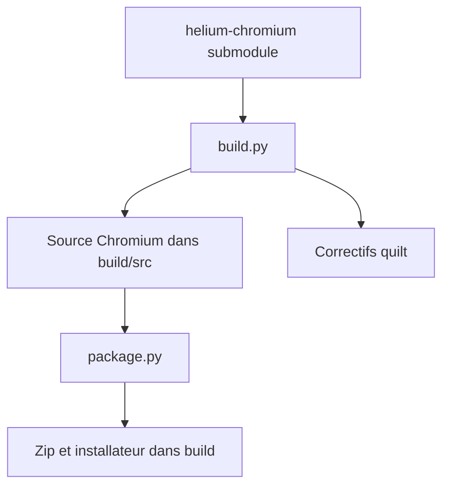

# imputnet/helium-windows

> Windows build and packaging scripts for the Helium browser, derived from ungoogled-chromium.

## The problem
Getting Windows binaries of Helium requires compiling Chromium with its patches.

## What it actually does
The repository builds on ungoogled-chromium-windows, heavily modified for Helium. `build.py` downloads and compiles Chromium, `package.py` produces a zip archive and an installer under `build`. A patch set managed with quilt (under MSYS2) and a pruning list are updated with scripts from `devutils`.

## How it is wired
Simplified diagram based on the sheet, no diagram provided.



## Trying it
```cmd
git clone --recurse-submodules https://github.com/imputnet/helium-windows.git
cd helium-windows
git checkout --recurse-submodules TAG_OR_BRANCH_HERE
python3 build.py
python3 package.py
```

## Cost and gotchas
Visual Studio, 7-Zip, Python 3.11 or later, MAX_PATH limit lifted and developer mode. Compiling Chromium takes a lot of disk, time and RAM; the team uses sponsored runners to go fast.

## What it is not
Not the browser itself nor its code: only the Windows packaging. An end user does not need to compile.

## Alternatives
ungoogled-chromium-windows, from which it derives.

## For you
Ignore: browser build tooling, unrelated to data / AI / MLOps work.
