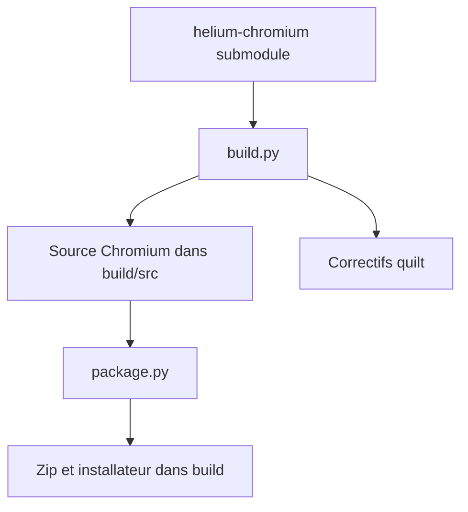

# imputnet/helium-windows

> Scripts de construction et d'empaquetage Windows du navigateur Helium, dérivé d'ungoogled-chromium.

## Le problème
Obtenir des binaires Windows de Helium exige de compiler Chromium avec ses correctifs.

## Ce que ça fait vraiment
Le dépôt reprend ungoogled-chromium-windows, très modifié pour Helium. `build.py` télécharge et compile Chromium, `package.py` produit une archive zip et un installateur sous `build`. Un jeu de correctifs géré avec quilt (sous MSYS2) et une liste d'élagage s'actualisent avec des scripts de `devutils`.

## Comment c'est branché
Schéma simplifié d'après la fiche, sans diagramme fourni.



## Essayer
```cmd
git clone --recurse-submodules https://github.com/imputnet/helium-windows.git
cd helium-windows
git checkout --recurse-submodules TAG_OR_BRANCH_HERE
python3 build.py
python3 package.py
```

## Coût et pièges
Visual Studio, 7-Zip, Python 3.11 ou plus, limite MAX_PATH levée et mode développeur. Une compilation de Chromium demande beaucoup de disque, de temps et de RAM ; l'équipe utilise des exécuteurs sponsorisés pour aller vite.

## Ce que ce n'est pas
Pas le navigateur lui-même ni son code : seulement l'empaquetage Windows. Un utilisateur final n'a pas à compiler.

## Alternatives
ungoogled-chromium-windows, dont il dérive.

## Pour toi
À ignorer : outillage de compilation d'un navigateur, sans lien avec le travail data / IA / MLOps.

