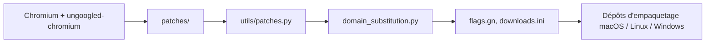

# imputnet/helium

> Privacy-oriented Chromium-based browser with a built-in ad blocker.

## The problem
Standard Chromium browsers ship with tracking and extras; making them lean means maintaining patches.

## What it actually does
The repository is mostly a patch pipeline on top of ungoogled-chromium: patch series (core, extra, Helium-specific, upstream fixes), Python scripts (`utils/`), domain substitution, binary pruning, resource generation and GN/Ninja configuration. It integrates patches from Inox, Debian, Bromite, Iridium and Brave. Packaging is done in three separate repositories (macOS, Linux, Windows). It includes a modified version of uBlock Origin.

## How it is wired

## Trying it
No command documented: download from helium.computer or the GitHub releases; development instructions are in the macOS repository.

## Cost and gotchas
Free. "Beta" status: problems are announced as possible. GPL-3.0 license (copyleft); Chromium code remains under BSD-3-Clause.

## What it is not
Not a scraping or automation tool. Rebuilding the browser requires the full Chromium toolchain.

## Alternatives
No alternative cited in the README (ungoogled-chromium is the project's base).

## For you
Ignore: yet another browser unrelated to data / AI work; a personal privacy choice.
