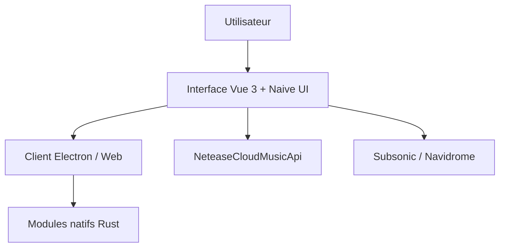

# imsyy/SPlayer

> Vue 3 and Electron music player connected to NetEase Cloud Music and Subsonic.

## The problem
Listening to your local and online music with a polished, cross-platform, synced player.

## What it actually does
Plays online music, local music and music from Subsonic or Navidrome servers, with word-by-word lyrics, spectrum, colors adapted to the cover art and Last.fm. Available as an Electron client, a website and a Docker image. The README announces a maintenance mode: new features go to SPlayer-Next.

## How it is wired
Simplified diagram based on the fiche, no diagram provided.


## Trying it
```bash
docker run -d --name SPlayer -p 25884:25884 imsyy/splayer:latest
# puis http://localhost:25884
```

## Cost and gotchas
Free. Depends on a NeteaseCloudMusicApi instance for web mode. Native build: Node 20 and pnpm 10, Rust (or SKIP_NATIVE_BUILD=true). AGPL-3.0, non-commercial use required.

## What it is not
Not an active project: archived and in maintenance. No full mobile version.

## Alternatives
- SPlayer-Next: the successor recommended by the author.

## For you
Ignore: an archived music player, unrelated to data or MLOps work.
