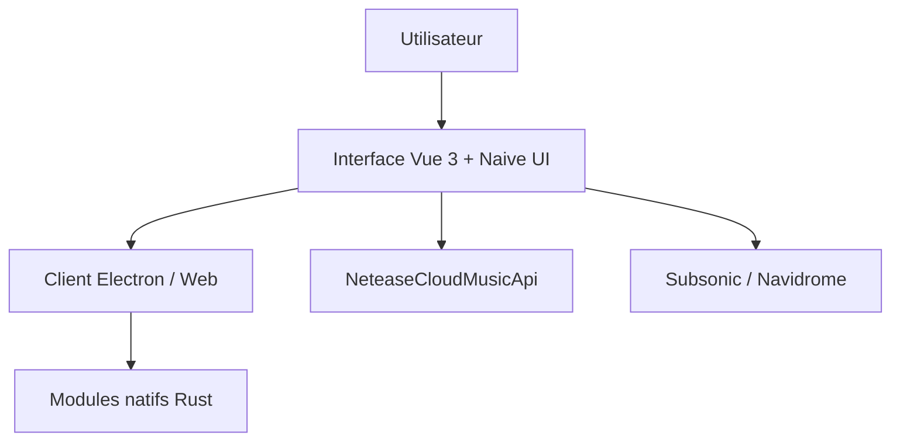

# imsyy/SPlayer

> Lecteur de musique Vue 3 et Electron branché sur NetEase Cloud Music et Subsonic.

## Le problème
Écouter sa musique locale et en ligne avec un lecteur soigné, multiplateforme et synchronisé.

## Ce que ça fait vraiment
Lit la musique en ligne, locale et via des serveurs Subsonic ou Navidrome, avec paroles mot à mot, spectre, couleurs adaptées à la pochette et Last.fm. Disponible en client Electron, en site web et en image Docker. Le README annonce un mode maintenance : les nouveautés vont vers SPlayer-Next.

## Comment c'est branché
Schéma simplifié d'après la fiche, sans diagramme fourni.


## Essayer
```bash
docker run -d --name SPlayer -p 25884:25884 imsyy/splayer:latest
# puis http://localhost:25884
```

## Coût et pièges
Gratuit. Dépend d'une instance NeteaseCloudMusicApi pour le mode web. Build natif : Node 20 et pnpm 10, Rust (ou SKIP_NATIVE_BUILD=true). AGPL-3.0, usage non commercial exigé.

## Ce que ce n'est pas
Pas un projet actif : archivé et en maintenance. Pas de version mobile complète.

## Alternatives
- SPlayer-Next : suite recommandée par l'auteur.

## Pour toi
À ignorer : lecteur de musique archivé, sans rapport avec un travail data ou MLOps.

