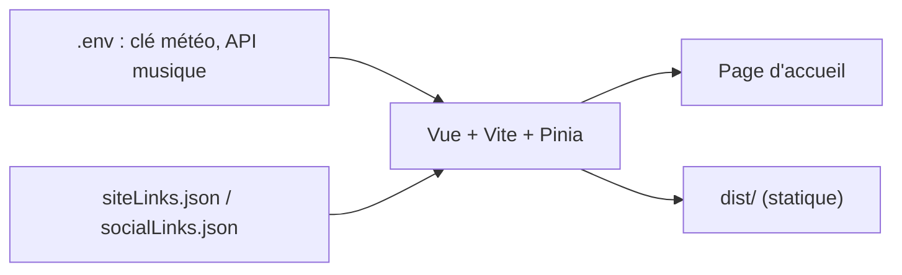

# imsyy/home

> Small personal start page in Vue, with weather, music and a quote, now archived.

## The problem
Having a simple, attractive personal start page to self-host.

## What it actually does
Static page with a loading animation, site introduction, Hitokoto quote, date and time, weather (Amap API), time progress bar, Aplayer/MetingJS music player (netease or QQ Music, mainland China only) and mobile adaptation. Links and background are configured in `src/assets` and `public/images`. The author archived the repository: code judged messy and resold by third parties.

## How it is wired


## Trying it
```bash
npm install -g pnpm
pnpm install
pnpm dev
pnpm build
docker build -t home . && docker run -p 12445:12445 -d home
```

## Cost and gotchas
Free. Weather requires an Amap key; music only works in mainland China. Archived repository (last push May 2025).

## What it is not
Not maintained. The author himself admits low code quality.

## Alternatives
None cited in the README.

## For you
Ignore: archived, by its author's own admission low quality, and unrelated to your field.
