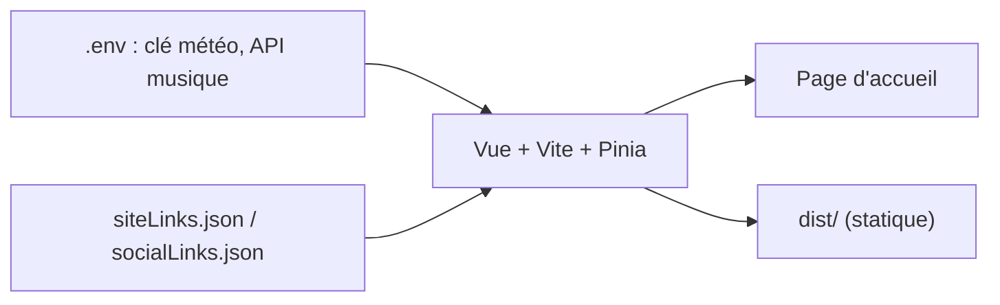

# imsyy/home

> Petite page d'accueil personnelle en Vue, avec météo, musique et citation, désormais archivée.

## Le problème
Avoir une page d'accueil personnelle simple et esthétique, à héberger soi-même.

## Ce que ça fait vraiment
Page statique avec animation de chargement, présentation du site, citation Hitokoto, date et heure, météo (API Amap), barre de progression du temps, lecteur de musique Aplayer/MetingJS (netease ou QQ Music, continent chinois uniquement) et adaptation mobile. Les liens et le fond se configurent dans `src/assets` et `public/images`. L'auteur archive le dépôt : code jugé brouillon et revendu par des tiers.

## Comment c'est branché


## Essayer
```bash
npm install -g pnpm
pnpm install
pnpm dev
pnpm build
docker build -t home . && docker run -p 12445:12445 -d home
```

## Coût et pièges
Gratuit. La météo exige une clé Amap ; la musique ne fonctionne qu'en Chine continentale. Dépôt archivé (dernier push en mai 2025).

## Ce que ce n'est pas
Pas maintenu. L'auteur reconnaît lui-même une qualité de code faible.

## Alternatives
Aucune citée dans le README.

## Pour toi
Ignorer : archivé, de l'aveu de son auteur de faible qualité, et sans lien avec ton métier.

