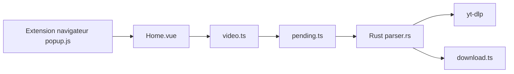

# imsyy/yt-dlp-gui

> Tauri desktop interface for yt-dlp, to download videos without using the command line.

## The problem
yt-dlp is powerful but intimidating on the command line.

## What it actually does
A Tauri 2 (Rust) and Vue 3 app: paste a URL, preview and formats, download queue (pause, resume), playlists, time-range cutting, re-encoding, SponsorBlock integration, cookies, proxy and rate limiter. Toolbox: thumbnails, subtitles, live chat archive, yt-dlp plugins. A Chrome/Edge extension sends the URL and cookies via the `ytdlp-gui://` protocol.

## How it is wired


## Trying it
```bash
sudo pacman -S fuse2
chmod +x YDL.GUI_*.AppImage
./YDL.GUI_*.AppImage
yt-dlp-gui --url "https://example.com/video" --dir "/path/to/downloads"
pnpm tauri:dev
```

## Cost and gotchas
Free. On first launch, yt-dlp is downloaded from the settings; Deno is recommended for all YouTube formats. Cookies stay local according to the README.

## What it is not
Not a replacement for yt-dlp: it wraps it. Downloads must respect content rights.

## Alternatives
The README names no alternative; it relies on yt-dlp.

## For you
Worth watching: handy for fetching videos, subtitles and transcripts as raw material, but a yt-dlp script is enough for a technical profile.
