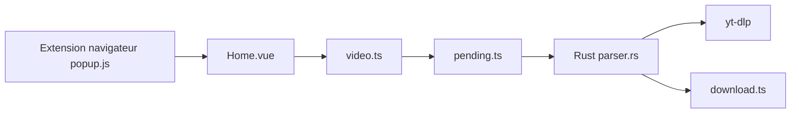

# imsyy/yt-dlp-gui

> Interface de bureau Tauri pour yt-dlp, pour télécharger des vidéos sans passer par la ligne de commande.

## Le problème
yt-dlp est puissant mais intimidant en ligne de commande.

## Ce que ça fait vraiment
Une app Tauri 2 (Rust) et Vue 3 : colle une URL, aperçu et formats, file de téléchargement (pause, reprise), playlists, découpe par plage de temps, réencodage, intégration SponsorBlock, cookies, proxy et limiteur de débit. Boîte à outils : miniatures, sous-titres, archive de chat en direct, plugins yt-dlp. Une extension Chrome/Edge envoie l'URL et les cookies via le protocole `ytdlp-gui://`.

## Comment c'est branché


## Essayer
```bash
sudo pacman -S fuse2
chmod +x YDL.GUI_*.AppImage
./YDL.GUI_*.AppImage
yt-dlp-gui --url "https://example.com/video" --dir "/path/to/downloads"
pnpm tauri:dev
```

## Coût et pièges
Gratuit. Au premier lancement, yt-dlp est téléchargé depuis les réglages ; Deno est conseillé pour tous les formats YouTube. Les cookies restent locaux selon le README.

## Ce que ce n'est pas
Pas un remplaçant de yt-dlp : il l'enveloppe. Le téléchargement doit respecter les droits des contenus.

## Alternatives
Le README ne nomme aucune alternative ; il s'appuie sur yt-dlp.

## Pour toi
À surveiller : pratique pour récupérer vidéos, sous-titres et transcriptions comme matière première, mais un script yt-dlp suffit à un profil technique.

